<p align="center">
  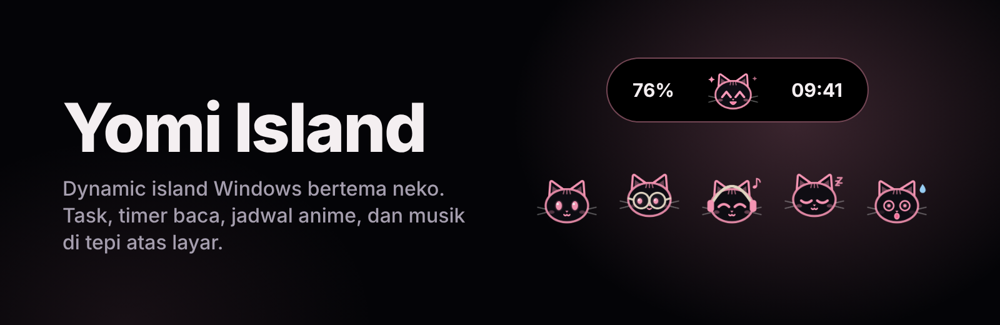
</p>

<p align="center">
  <a href="https://github.com/CrFebrian/Dynamic-Neko/releases/latest"></a>
  
  
  
</p>

<p align="center">
  <a href="#-unduh">Unduh</a> ·
  <a href="#-tentang-yomi-island">Tentang</a> ·
  <a href="#-fitur">Fitur</a> ·
  <a href="#-neko-dan-ekspresinya">Neko</a> ·
  <a href="#-teknologi">Teknologi</a> ·
  <a href="#-struktur-project">Struktur</a>
</p>

---

## ⬇️ Unduh

<p align="center">
  <a href="https://github.com/CrFebrian/Dynamic-Neko/releases/latest"><b>👉 Unduh Yomi Island dari halaman rilis</b></a>
</p>

Tautan di atas membuka halaman rilis GitHub. Ambil berkas **`…-setup.exe`** terbaru, lalu jalankan.

<details>
<summary><b>Cara memasang</b> (klik untuk membuka)</summary>

1. Unduh berkas `…-setup.exe` dari halaman rilis.
2. Jalankan berkas tersebut. Jika Windows menampilkan **"Windows protected your PC"**, pilih **Informasi lebih lanjut**, lalu **Tetap jalankan**.
3. Setelah selesai, pill kecil muncul di tengah tepi atas layar. Klik untuk membuka panelnya.
4. Yomi Island **terbuka sendiri setiap Windows dinyalakan**. Tombol **Keluar** di Pengaturan hanya menutupnya untuk sesi itu. Untuk menghentikan selamanya, matikan di Pengaturan Windows → Aplikasi → Startup, atau copot pemasangan.

**Syarat:** Windows 10 atau 11 (64-bit).
Peringatan SmartScreen itu wajar, karena installer belum bertanda tangan digital. Unduh hanya dari halaman rilis resmi di atas.

**Mencopot:** Pengaturan Windows → Aplikasi → Yomi Island.

</details>

---

## 🐾 Tentang Yomi Island

**Yomi Island** (yomi = membaca) adalah *dynamic island* untuk Windows: pill kecil di tepi atas layar yang selalu terlihat, tapi tidak mengganggu. Pill menampilkan **baterai** di kiri, **neko** di tengah, dan **jam** di kanan. Klik pill, dan terbuka panel berisi task hari ini, timer baca, jadwal tayang anime, kontrol musik, dan alat santai.

Dibuat untuk **pembaca manga, penggemar anime**, dan siapa pun yang butuh pengingat harian yang ramah. Neko di dalamnya berubah ekspresi sesuai keadaanmu: semangat saat ada yang perlu dikerjakan, kaget kalau sudah terlambat, tidur ketika semuanya beres.

Semua data **tersimpan di laptopmu**, tanpa akun dan tanpa telemetri. Gratis untuk pemakaian pribadi.

<p align="center">
  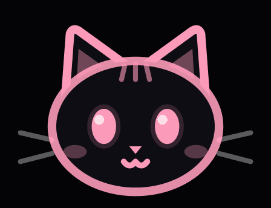
  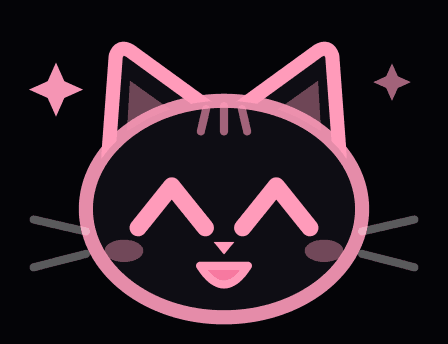
  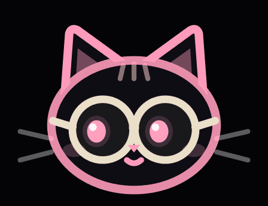
  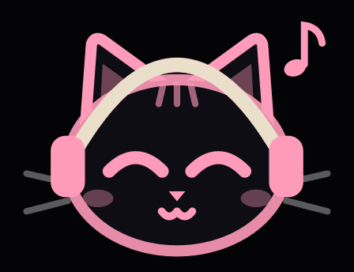
  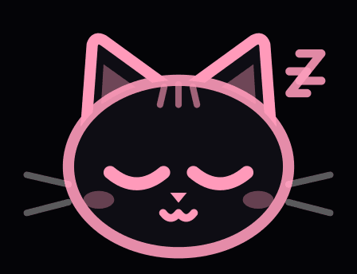
</p>

---

## ✨ Fitur

| | Fitur | Yang bisa kamu lakukan |
|---|---|---|
| 📅 | **Hari ini** | Catat task dengan jam, lihat tanggal lengkap, dan dapat pengingat di pill sebelum waktunya habis (bunyi bisa dimatikan) |
| 📖 | **Baca** | Timer Baca (25 menit), Fokus (50 menit), dan Rehat (5 menit), **target halaman harian**, daftar buku dengan progres, dan hitungan hari beruntun membaca |
| 📺 | **Anime dan manga** | **Hitung mundur episode** berikutnya dari AniList dan **update bab manga** dari MangaDex, dicek tiap 30 menit dan diberi tahu lewat pill. Bahasa bab bisa diubah |
| 🎵 | **Musik** | Judul, artis, putar/jeda, lagu berikutnya/sebelumnya, **volume Windows**, bilah progres, dan **lirik berjalan** dari LRCLIB (opsional) |
| 🌸 | **Santai** | **Istirahat mata 20-20-20**, kutipan harian, penanda saat layar direkam, pengingat **reset harian game**, dan **suara latar lo-fi** |
| 🎙️ | **Mode rapat** | Saat mikrofon dipakai, pengingat dan bunyi ditahan dan pill menjadi indikator rapat |
| 🎬 | **Mode nonton** | Saat ada video atau game layar penuh, island bersembunyi dan pengingat ditahan |
| ⚙️ | **Pengaturan** | Jendela sendiri dengan pencarian: tema gelap/terang/ikut sistem, gaya island, isi pill, tutup otomatis, dan notifikasi per fitur |
| 🔔 | **Pembaruan** | Memberi tahu lewat pill bila ada versi baru di GitHub Releases (paling sering 12 jam sekali, bisa dimatikan) |
| 🧭 | **Tur pengenalan** | Penjelasan singkat letak fitur saat pertama dipakai, bisa diulang dari Pengaturan |

<details>
<summary><b>🧠 Panel langsung membuka tab yang relevan</b></summary>
<br>

Saat panel dibuka, tab yang sedang berjalan tampil lebih dulu: istirahat mata atau penanda rekam membuka **Santai**, timer berjalan membuka **Baca**, dan musik yang diputar membuka **Musik**. Tanpa kegiatan, panel membuka **Hari ini**.

</details>

<details>
<summary><b>🖥️ Detail tampilan dan kontrol</b></summary>
<br>

- Seret pill atau bagian atas panel ke kiri dan kanan; posisinya diingat dan menyesuaikan ukuran layar.
- Ikon di tray punya menu **Pengaturan**, **Tampilkan/sembunyikan island**, dan **Keluar**.
- Tema terang dan gelap, dengan neko yang tetap gelap seperti stiker.
- Navigasi tab lewat ikon; nama tab tampil saat dipilih.
- Animasi mengikuti pengaturan "kurangi gerakan" milik Windows.

</details>

---

## 🐱 Neko dan ekspresinya

Pill cukup dilirik sekilas: dari ekspresi neko kamu sudah tahu keadaanmu.

| Ekspresi | Muncul saat |
|---|---|
| 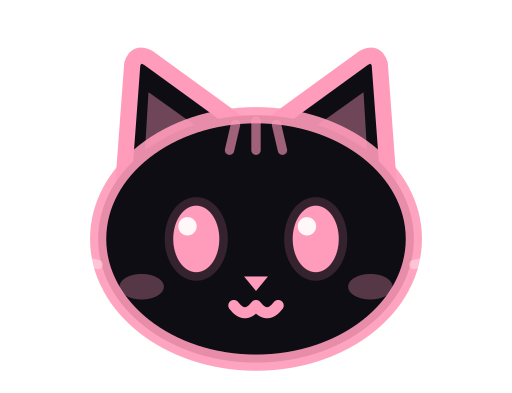 **Siaga** | Task masih lama, atau sedang rapat/merekam (dengan titik penanda) |
| 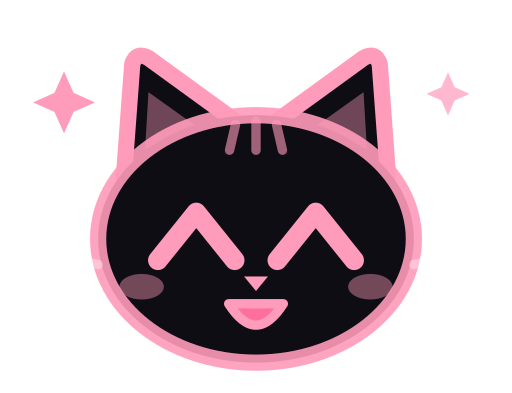 **Semangat** | Task kurang dari 15 menit lagi, sesi timer selesai, target halaman tercapai, atau ada episode/bab baru |
| 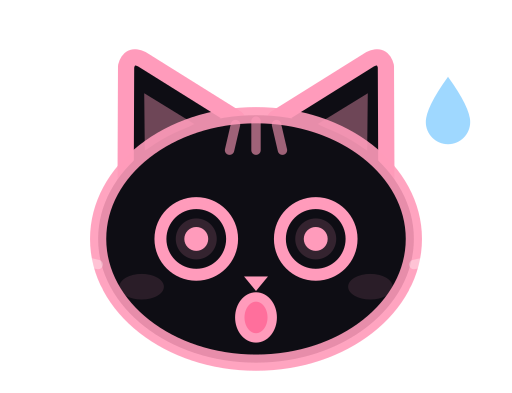 **Kaget** | Task baru saja lewat batas waktu (sampai 10 menit) |
| 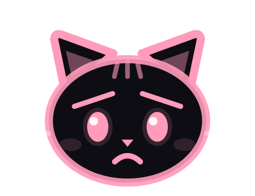 **Sedih** | Task terlambat lebih dari 10 menit |
| 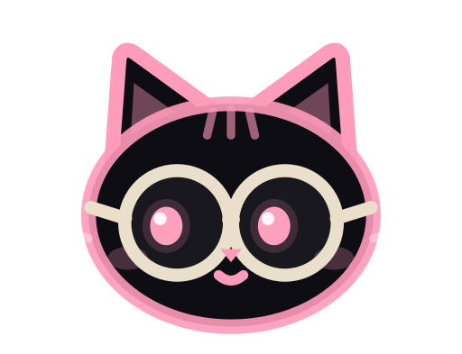 **Membaca** | Timer baca atau fokus sedang berjalan |
| 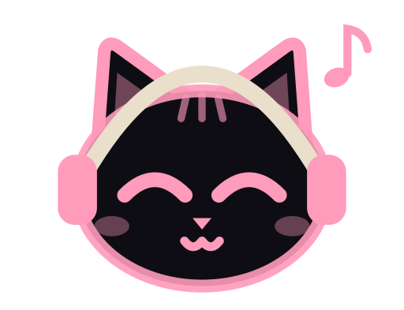 **Mendengar musik** | Ada lagu yang diputar |
| 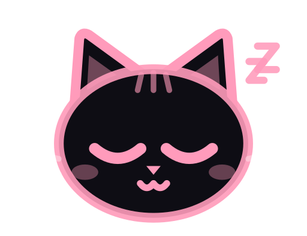 **Tidur** | Tidak ada kegiatan, waktunya istirahat mata, atau layar penuh (island bersembunyi) |

Yomi Island juga memeriksa versi baru di GitHub Releases dan memberi tahu lewat pill (bisa dimatikan di Pengaturan).

**Ada masalah?** Buka Pengaturan → *Ada masalah?* untuk membuka folder log dan mengirim laporan lewat formulir GitHub. Catatan error ditulis ke berkas `error.log` di folder data aplikasi, dan isinya baru dikirim kalau kamu sendiri melaporkan masalah. Isi laporan kamu tinjau dulu sebelum dikirim.

---

## 🛠️ Teknologi

| Teknologi | Dipakai untuk |
|---|---|
| **Tauri 2** (Rust) | Jendela island transparan, ikon tray, dan akses API Windows |
| **React 19** + **TypeScript** + **Vite 7** | Antarmuka island dan jendela Pengaturan |
| **Windows API** (crate `windows`) | Pemutar media (SMTC), volume utama, baterai, status layar penuh, dan mikrofon |
| **SQLite** (`tauri-plugin-sql`) | Penyimpanan data lokal |
| **`tauri-plugin-http`** | Permintaan jaringan yang dibatasi ke daftar host tertentu |
| **Web Audio** | Musik lo-fi sintetis untuk suara latar |
| **AniList**, **MangaDex**, **LRCLIB** | Sumber data anime, manga, dan lirik (API publik, tanpa kunci) |

---

## 🧱 Struktur project

<details>
<summary><b>Buka struktur folder</b></summary>

```
├── src/                       antarmuka (React + TypeScript)
│   ├── app/                   App utama: jendela, notifikasi, siklus pill
│   ├── island/                pill, panel, tab, tur, dan logika keadaan pill
│   │   └── tabs/              Hari ini, Baca, Anime, Musik, Santai
│   ├── settings/              jendela Pengaturan dan katalognya
│   ├── features/              logika murni per fitur (tasks, reading, anime,
│   │                          manga, lyrics, eye, gacha, ambient, update, ...)
│   ├── mascot/                neko dan ekspresinya
│   ├── lib/                   penyimpanan, setting, http, util
│   └── styles/
├── src-tauri/                 sisi Rust
│   ├── src/system/            pembacaan keadaan Windows (media, volume, mic, ...)
│   ├── src/lib.rs             command Tauri, tray, jendela Pengaturan
│   └── capabilities/          izin jendela (jaringan, database, event)
├── public/music/              lagu untuk suara latar
├── assets/                    maskot dan ikon (PNG, SVG, GIF)
├── docs/                      website dan gambar README
└── tools/                     skrip pembuat aset maskot
```

</details>

---

## 📄 Lisensi

Yomi Island memakai **lisensi sumber terlihat (source-available)**: kode boleh dibaca dan dipakai untuk keperluan pribadi non-komersial. Menjual, memakai komersial, atau membagikan ulang tidak diizinkan tanpa izin. Baca selengkapnya di [`LICENSE.txt`](LICENSE.txt).

---

<p align="center">
  <b>© 2026 CrFebrian. All rights reserved.</b><br>
  <sub>Dibuat dengan ☕ dan seekor neko yang suka mengingatkan.</sub><br>
  <sub><a href="https://saweria.co/BrianCoding">Traktir lewat Saweria</a> · <a href="https://github.com/CrFebrian/Dynamic-Neko/issues">Laporkan masalah</a></sub>
</p>
